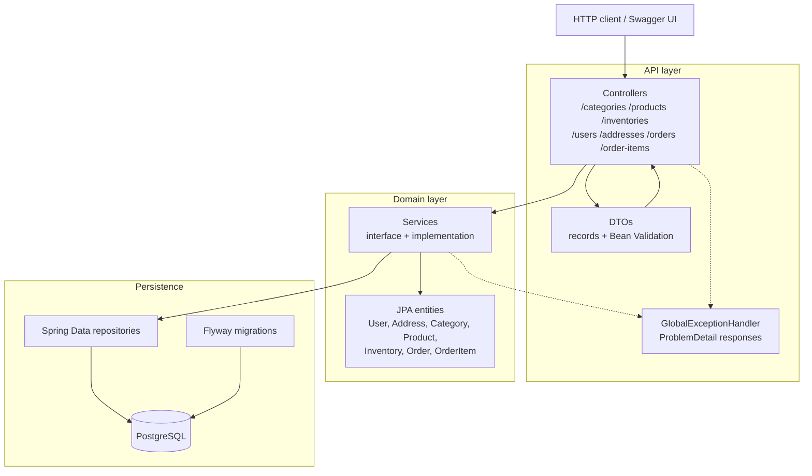
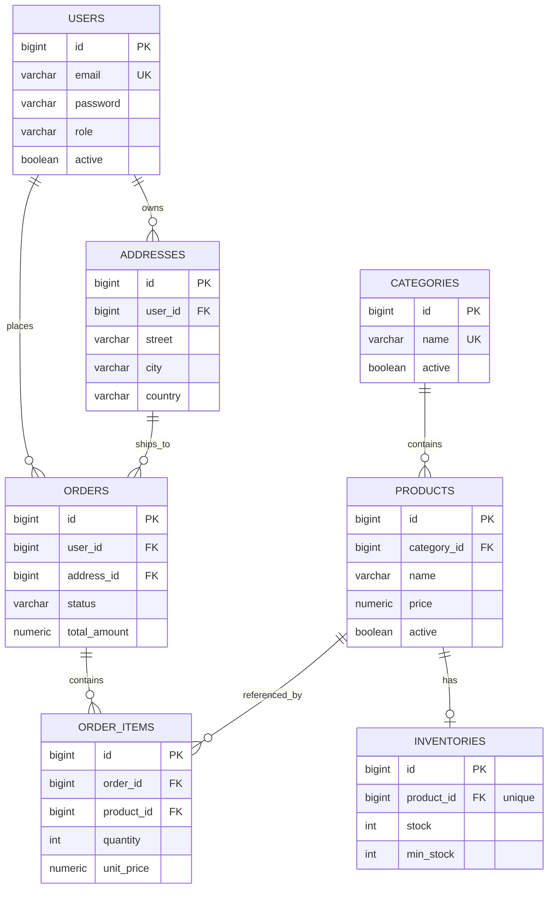
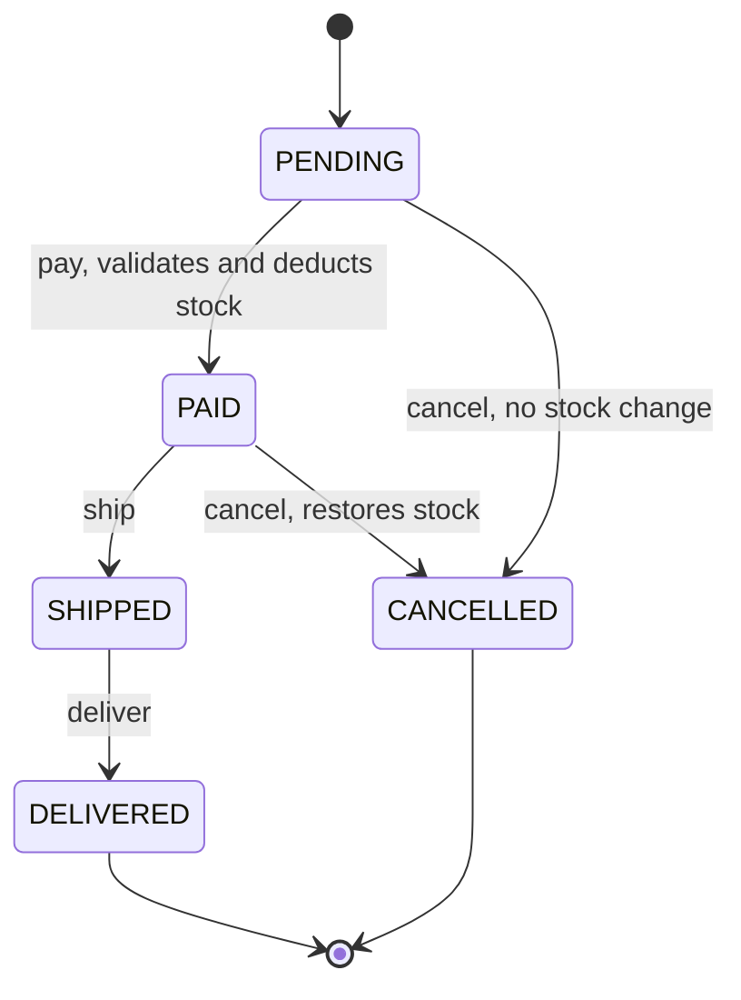
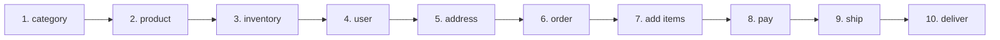

# E-commerce REST API

A small, focused e-commerce backend built with **Spring Boot 4.1.1** and **Java 21**.
It exposes a REST API for a product catalog, customers, addresses, inventory and a complete order
lifecycle with stock control. The project is a portfolio piece: the goal is to show a clean layered
architecture and a handful of well-implemented business rules, not to cover every production concern.

---

## Quick start

### Requirements

| Tool | Version |
| --- | --- |
| Java | 21+ |
| PostgreSQL | 14+ (developed against 18) |
| Maven | not required, the Maven Wrapper is included |

### 1. Create the database

```sql
CREATE DATABASE ecomerce;
```

The schema is **not** created by Hibernate. Flyway runs the migrations in
`src/main/resources/db/migration` automatically on startup, and Hibernate validates the result
(`ddl-auto=validate`). A fresh database is enough.

### 2. Configure credentials

The app reads `DB_USER` and `DB_PASS` from the environment. A template is included:

```bash
cp .env.example .env
```

```properties
# .env
DB_USER=your_user
DB_PASS=your_password
```

`.env` is only a local file. Spring Boot does not read it on its own: load it in your IDE run
configuration, export the variables in your shell, or pass them to Maven.

PowerShell:

```powershell
$env:DB_USER = "your_user"
$env:DB_PASS = "your_password"
.\mvnw.cmd spring-boot:run
```

Bash:

```bash
export DB_USER=your_user
export DB_PASS=your_password
./mvnw spring-boot:run
```

Defaults if the variables are missing: `user` / `password`.

### 3. Open the API

| Resource | URL |
| --- | --- |
| Base URL | `http://localhost:8080` |
| Swagger UI | `http://localhost:8080/swagger` |
| OpenAPI JSON | `http://localhost:8080/v3/api-docs` |

### 4. Run the tests

```bash
./mvnw test          # Windows: .\mvnw.cmd test
```

> **PostgreSQL is required for the test suite.** There is no test profile and no in-memory
> database, so the `@SpringBootTest` tests fail if the database is not reachable. The controller
> slice tests (`@WebMvcTest`) do not touch the database, but Maven runs the whole suite.

A single test class or method:

```bash
./mvnw -Dtest=OrderLifecycleIntegrationTest test
./mvnw -Dtest=CategoryControllerTest#createReturns201AndBody test
```

---

## Things to know before you start

- **The database must exist** before the first run. Flyway creates the tables, not the database.
- **Never edit an applied migration.** Add a new `V<n>__description.sql` instead; otherwise the
  checksum validation fails at startup.
- **If tables were created by Hibernate before Flyway**, migration `V1` will fail. In development,
  reset the schema with `DROP SCHEMA public CASCADE; CREATE SCHEMA public;` and start again.
- **There is no authentication.** Every endpoint is open and the `role` field is data only.
- **Passwords are stored in plain text.** This is a portfolio trade-off, not a production design.
- **There is no pagination.** List endpoints return every row.
- **Stock is deducted when the order is paid**, not when an item is added.
- `spring.jpa.show-sql=true` logs every query; expect verbose console output.
- The order table is named `orders` because `order` is a reserved word in SQL.

---

## Tech stack

- Spring Boot 4.1.1 (Web MVC, Data JPA, Validation, Flyway)
- Java 21, Maven Wrapper
- PostgreSQL
- Lombok
- springdoc-openapi 3.1.0 (Swagger UI)
- JUnit 5, MockMvc, Mockito

---

## Architecture

The project follows a classic layered flow. Controllers never expose JPA entities: every response is
mapped to a DTO, and repositories use `@EntityGraph` to load the associations the DTOs need
(`open-in-view` is disabled).



**Package layout** (`com.angel.ecomerce`):

```text
entity/            JPA entities and enums (Role, OrderStatus)
repository/        Spring Data JPA interfaces
service/<domain>/  I<Domain> contract + implementation
dto/<domain>/      Request/response records and entity mapping
controller/        REST controllers
exception/         GlobalExceptionHandler -> ProblemDetail
```

**Service contract** used across all domains:

- `save` only creates; it rejects entities that already have an `id`.
- `updateById` returns the updated entity and throws `NoSuchElementException` when missing.
- `find*` methods return `Optional`.
- `delete*` / `deactivate*` return `void` and throw when the resource is missing or protected.

Errors are translated to HTTP by the global handler:

| Exception | Status |
| --- | --- |
| `NoSuchElementException` | `404 Not Found` |
| `IllegalArgumentException` | `400 Bad Request` |
| `IllegalStateException` | `409 Conflict` |
| Bean Validation errors | `400` with an `errors` map per field |

---

## Data model



**Deletion rules** protect history instead of cascading everywhere:

- A category with products cannot be deleted (`409`).
- A product referenced by order items cannot be deleted; deactivate it instead.
- A user or address referenced by orders cannot be deleted; deactivate the user instead.
- Order items are removed with the order (`cascade ALL` + `orphanRemoval`).
- Inventory is removed with its product (`ON DELETE CASCADE`).
- Money is `BigDecimal(12, 2)`.

---

## Order lifecycle



Rules enforced by `OrderService`:

- Orders start as `PENDING`, with `totalAmount = 0.00` and no items.
- The user must be active and the address must belong to that same user.
- Items can only be added, updated, removed, or the order deleted while `PENDING`.
- Adding a product that already exists in the order increments its quantity instead of duplicating it.
- `unitPrice` is frozen from the product price at the moment the item is added.
- `totalAmount` is recalculated as `sum(quantity * unitPrice)` after every change.
- Paying requires at least one item, an existing inventory and enough stock; otherwise `409` and the
  order stays `PENDING`.
- Sending the same status twice is idempotent: no transition and no stock movement.
- Cancelling an already `CANCELLED` order is idempotent.
- `SHIPPED` and `DELIVERED` orders cannot be cancelled (`400`).
- Only `PENDING` orders can be deleted (`409` otherwise).

Stock behavior is intentionally simple: adding items does **not** reserve stock. Stock is checked and
deducted when the order becomes `PAID`, and restored when a `PAID` order is cancelled. There is no
pessimistic or optimistic locking, so concurrent payments can oversell.

---

## API overview

All routes are plural and return JSON. Full request/response schemas are available in Swagger UI.

| Resource | Base path | Endpoints |
| --- | --- | ---: |
| Categories | `/categories` | 9 |
| Products | `/products` | 10 |
| Inventories | `/inventories` | 11 |
| Users | `/users` | 8 |
| Addresses | `/addresses` | 7 |
| Orders | `/orders` | 11 |
| Order items | `/order-items` | 3 |
| **Total** | | **59** |

### Suggested order of use

Dependencies matter: create the catalog first, then the customer, then the order.



Quick walkthrough with `curl` (bash, requires [`jq`](https://jqlang.github.io/jq/)):

```bash
BASE=http://localhost:8080

CATEGORY=$(curl -s -X POST $BASE/categories \
  -H "Content-Type: application/json" \
  -d '{"name":"Books","description":"Books and magazines"}')
CATEGORY_ID=$(echo "$CATEGORY" | jq -r .id)

PRODUCT=$(curl -s -X POST $BASE/products \
  -H "Content-Type: application/json" \
  -d "{\"name\":\"Java Book\",\"price\":19.99,\"categoryId\":$CATEGORY_ID}")
PRODUCT_ID=$(echo "$PRODUCT" | jq -r .id)

curl -s -X POST "$BASE/inventories?productId=$PRODUCT_ID" \
  -H "Content-Type: application/json" \
  -d '{"stock":10,"minStock":2}'

USER=$(curl -s -X POST $BASE/users \
  -H "Content-Type: application/json" \
  -d '{"name":"Ana","email":"ana@example.com","password":"secret123"}')
USER_ID=$(echo "$USER" | jq -r .id)

ADDRESS=$(curl -s -X POST "$BASE/addresses?userId=$USER_ID" \
  -H "Content-Type: application/json" \
  -d '{"street":"Main St 1","city":"Springfield","country":"US"}')
ADDRESS_ID=$(echo "$ADDRESS" | jq -r .id)

ORDER=$(curl -s -X POST $BASE/orders \
  -H "Content-Type: application/json" \
  -d "{\"userId\":$USER_ID,\"addressId\":$ADDRESS_ID}")
ORDER_ID=$(echo "$ORDER" | jq -r .id)

curl -s -X POST "$BASE/orders/$ORDER_ID/items" \
  -H "Content-Type: application/json" \
  -d "{\"productId\":$PRODUCT_ID,\"quantity\":2}"

curl -s -X PATCH "$BASE/orders/$ORDER_ID/status" \
  -H "Content-Type: application/json" \
  -d '{"status":"PAID"}'
```

### Endpoint highlights

- `GET /categories/heartbeat` → plain text `alive`.
- `GET /categories/by-name?name=...` and `GET /users/by-email?email=...` are case-insensitive and
  trimmed; a missing resource returns `404`.
- `GET /products/search?name=...` performs a case-insensitive partial search and only returns
  active products.
- `GET /products/category/{id}` returns an empty list when the category does not exist.
- `GET /inventories/product/{id}/low-stock` returns a raw boolean, not an object.
- `lowStock` is `true` when `stock <= minStock`.
- `PATCH /inventories/product/{id}/increase|decrease?quantity=N` requires `N > 0`; a decrease larger
  than the current stock returns `409`.
- `DELETE /orders/{orderId}/items/{itemId}` returns `200` with the updated order, not `204`.
- `PUT /orders/{orderId}/items/{itemId}` with `quantity: 0` removes the item.
- There is no endpoint to change the user or address of an existing order.

### Status codes

| Code | Meaning |
| --- | --- |
| `200` | Query, update, deactivate, payment, cancellation, item change |
| `201` | Resource created |
| `204` | Deleted, no body |
| `400` | Validation, bad data, invalid transition, malformed JSON |
| `404` | Missing resource |
| `409` | Stock conflict, non-`PENDING` order, protected history |

Errors use `ProblemDetail`:

```json
{
  "type": "about:blank",
  "title": "Bad Request",
  "status": 400,
  "detail": "The request contains invalid data",
  "errors": {
    "name": "El nombre es obligatorio"
  }
}
```

> Validation messages are in Spanish on purpose, to keep the domain language consistent.

---

## Tests

The suite is split by module instead of living in a single file. There are 56 tests.

| Type | Class | Tests | What it covers |
| --- | --- | ---: | --- |
| Context | `EcomerceApplicationTests` | 1 | The application context starts |
| Slice | `CategoryControllerTest` | 6 | CRUD contract, validation, `409` on delete |
| Slice | `ProductsControllerTest` | 7 | Search, category filter, create, deactivate, delete conflict |
| Slice | `InventoryControllerTest` | 7 | Create, validation, low stock, stock movements, delete |
| Slice | `UsersControllerTest` | 6 | Create, email validation, lookup, deactivate, delete conflict |
| Slice | `AddressesControllerTest` | 6 | Create, validation, ownership, delete rules |
| Slice | `OrdersControllerTest` | 7 | Create, invalid status, items, status change, cancel, delete |
| Slice | `OrderItemControllerTest` | 3 | List by order, missing item, delete |
| Integration | `CatalogIntegrationTest` | 4 | Unique category, product FK, low stock/overdraft, active search |
| Integration | `CustomerIntegrationTest` | 3 | Email normalization, duplicate email, address ownership |
| Integration | `OrderLifecycleIntegrationTest` | 6 | Full purchase, totals, stock, invalid transitions, ownership |

- **Slice tests** use `@WebMvcTest` + `@MockitoBean`: they check the HTTP contract without a database.
- **Integration tests** use a shared `@SpringBootTest` + `@AutoConfigureMockMvc` + `@Transactional`
  base (`IntegrationTestSupport`), so each scenario rolls back. Helpers build entities over HTTP.
- `TestFixtures` centralizes the entity builders used by the slice tests.

Test sources:

```text
src/test/java/com/angel/ecomerce/
├── EcomerceApplicationTests.java
├── controller/        # one class per module
├── integration/       # catalog, customers, order lifecycle + shared base
└── support/           # TestFixtures
```

`spring.jpa.show-sql=true` makes the integration test output noisy; that is expected.

---

## Project structure

```text
ecomerce/
├── pom.xml
├── mvnw / mvnw.cmd
├── .env.example
├── README.md
└── src/
    ├── main/
    │   ├── java/com/angel/ecomerce/
    │   │   ├── EcomerceApplication.java
    │   │   ├── controller/
    │   │   ├── dto/
    │   │   ├── entity/
    │   │   │   └── enums/
    │   │   ├── exception/
    │   │   ├── repository/
    │   │   └── service/
    │   └── resources/
    │       ├── application.properties
    │       └── db/migration/
    │           ├── V1__initial_schema.sql
    │           └── V2__normalize_schema_and_constraints.sql
    └── test/java/com/angel/ecomerce/
        ├── EcomerceApplicationTests.java
        ├── controller/
        ├── integration/
        └── support/
```

---

## Known limitations

These are deliberate scope decisions for a portfolio project:

- No authentication or authorization; the API is completely open.
- Passwords are stored in plain text. The user response omits the field, but nothing hashes it.
- No pagination, filtering or sorting beyond the few search endpoints.
- No concurrency control on stock; two simultaneous payments can oversell.
- Stock is deducted at payment time, not reserved when items are added.
- No order history endpoint beyond querying orders by user or status.
- No endpoint to change the user or address of an existing order.
- No endpoint to edit items from `/order-items`; use the `/orders` routes.
- Categories have no dedicated deactivation endpoint; use `PUT` with `active: false`.
- Deleting history is intentionally blocked, so test data must be cleaned in reverse order or with SQL.
- No Docker, CI pipeline, linter or formatter.
- The test suite depends on a running PostgreSQL instance.

---

## License

This project is intended as a learning and portfolio example. Use it freely as a reference.
