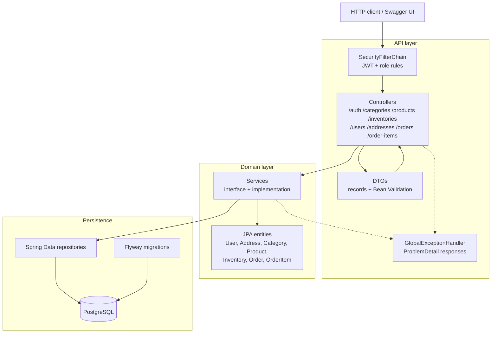
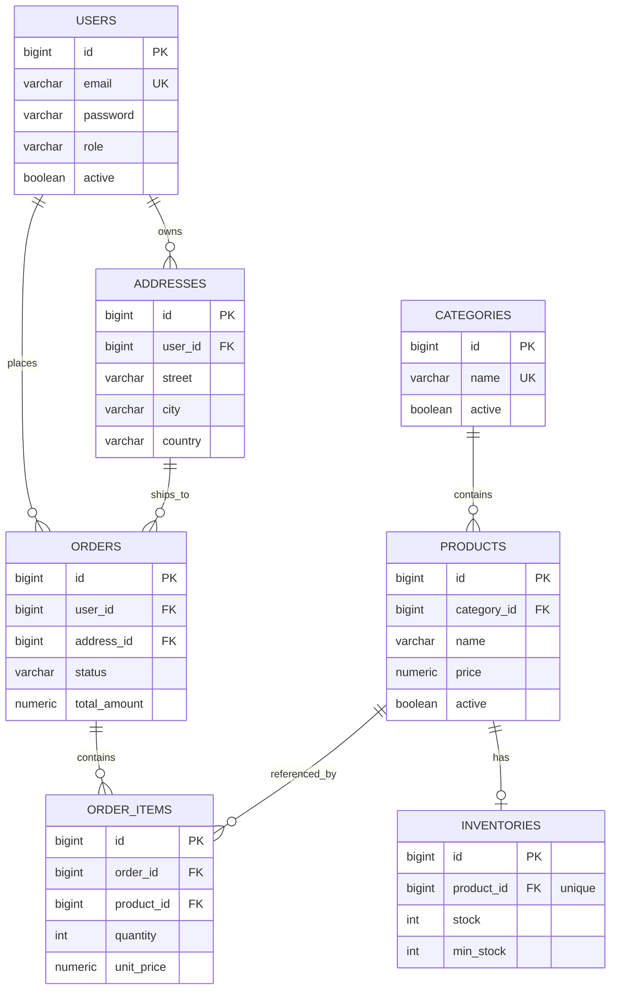
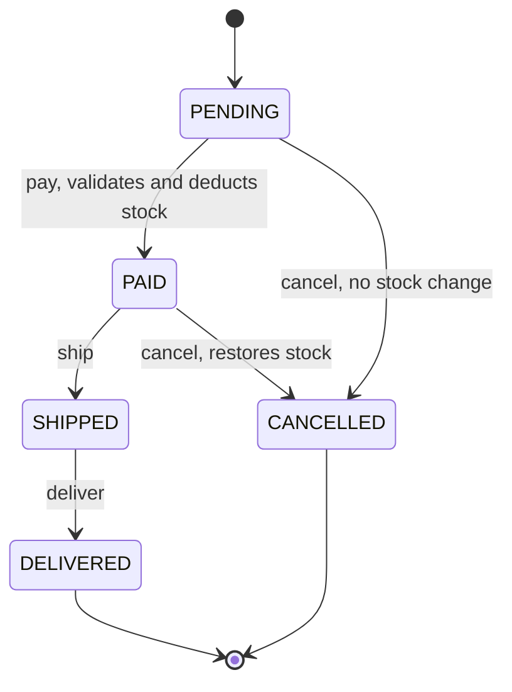
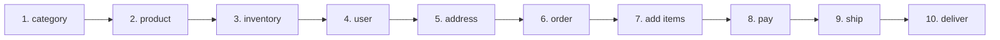

# E-commerce REST API

[](https://github.com/angeldavid2002/SpringEcomerce/actions/workflows/ci.yml)

A small, focused e-commerce backend built with **Spring Boot 4.1.1** and **Java 21**.
It exposes a REST API for a product catalog, customers, addresses, inventory and a complete order
lifecycle with stock control. The project is a portfolio piece: the goal is to show a clean layered
architecture and a handful of well-implemented business rules, not to cover every production concern.

---

## Quick start

### Requirements

| Tool | Version |
| --- | --- |
| Java | 21+ |
| PostgreSQL | 14+ (developed against 18) |
| Maven | not required, the Maven Wrapper is included |
| Docker (optional) | 24+ with Compose v2, only for the containerized setup |

### Docker Compose (optional)

If Docker is available, this replaces steps 1–3:

```bash
cp .env.example .env
# edit .env and set a real JWT_SECRET
docker compose up --build
```

The API is served at `http://localhost:8080` and Swagger at `/swagger`. PostgreSQL is published on
`localhost:5433` to avoid clashing with a local instance, and its data lives in the `postgres-data`
volume. The compose file mounts that volume at `/var/lib/postgresql`, as required by the PostgreSQL 18
image.

### Local setup

If you prefer to run the API on your machine, follow steps 1–4.

### 1. Create the database

```sql
CREATE DATABASE ecomerce;
```

The schema is **not** created by Hibernate. Flyway runs the migrations in
`src/main/resources/db/migration` automatically on startup, and Hibernate validates the result
(`ddl-auto=validate`). A fresh database is enough.

### 2. Configure environment variables

Secrets and algorithms live in environment variables. For local development, `application.properties`
imports the `.env` file automatically (it is ignored by Git), so you only need to create it:

```bash
cp .env.example .env
```

```properties
# .env
DB_URL=jdbc:postgresql://localhost:5432/ecomerce
DB_USER=your_user
DB_PASS=your_password

SEED_ENABLED=true
SEED_ADMIN_EMAIL=admin@example.com
SEED_ADMIN_PASSWORD=Admin1234!
SEED_CUSTOMER_EMAIL=customer@example.com
SEED_CUSTOMER_PASSWORD=Customer1234!

JWT_SECRET=replace-with-a-random-secret
JWT_ISSUER=ecomerce
JWT_EXPIRATION=PT1H
JWT_ALGORITHM=HS256

BCRYPT_STRENGTH=10

# Image storage (Backblaze B2). B2_ENABLED=false disables it: uploads answer 503.
B2_ENABLED=false
B2_ENDPOINT=https://s3.us-west-004.backblazeb2.com
B2_REGION=us-west-004
B2_BUCKET=your-bucket-name
B2_ACCESS_KEY=keyID-from-b2
B2_SECRET_KEY=applicationKey-from-b2
B2_PRESIGN_EXPIRATION=PT30M
B2_MAX_FILE_SIZE=5242880
B2_ALLOWED_CONTENT_TYPES=image/jpeg,image/png,image/webp,image/gif
B2_PREFIX=products
```

`spring.config.import=optional:file:.env[.properties]` loads `.env` as a properties file. Real
environment variables still work and take precedence, so CI and production can inject them without a
`.env` file.

| Variable | Required | Default | Purpose |
| --- | --- | --- | --- |
| `DB_URL` | No | `jdbc:postgresql://localhost:5432/ecomerce` | JDBC URL |
| `DB_USER` | Yes | — | Database user |
| `DB_PASS` | Yes | — | Database password |
| `SEED_ENABLED` | No | `false` | Creates the two demo users on startup |
| `SEED_ADMIN_EMAIL` / `SEED_ADMIN_PASSWORD` | If the seed is enabled | — | Demo `ADMIN` credentials |
| `SEED_CUSTOMER_EMAIL` / `SEED_CUSTOMER_PASSWORD` | If the seed is enabled | — | Demo `CUSTOMER` credentials |
| `JWT_SECRET` | Yes | — | HMAC signing secret. Minimum: 32 bytes (HS256), 48 (HS384), 64 (HS512) |
| `JWT_ISSUER` | No | `ecomerce` | `iss` claim |
| `JWT_EXPIRATION` | No | `PT1H` | Token lifetime (ISO-8601 duration) |
| `JWT_ALGORITHM` | No | `HS256` | `HS256`, `HS384` or `HS512` |
| `BCRYPT_STRENGTH` | No | `10` | BCrypt cost, from 4 to 31 |
| `B2_ENABLED` | No | `false` | Enables the Backblaze B2 image bucket |
| `B2_ENDPOINT` / `B2_REGION` | If enabled | — | Bucket endpoint and region, e.g. `https://s3.us-west-004.backblazeb2.com` |
| `B2_BUCKET` | If enabled | — | Private bucket name |
| `B2_ACCESS_KEY` / `B2_SECRET_KEY` | If enabled | — | B2 application key (`keyID` / `applicationKey`) |
| `B2_PRESIGN_EXPIRATION` | No | `PT30M` | Lifetime of the signed URLs returned to the client |
| `B2_MAX_FILE_SIZE` | No | `5242880` | Max bytes per image |
| `B2_ALLOWED_CONTENT_TYPES` | No | `image/jpeg,image/png,image/webp,image/gif` | Accepted image types |
| `B2_PREFIX` | No | `products` | Key prefix inside the bucket |

The application refuses to start if `JWT_SECRET` is missing or too short for the selected algorithm,
or if the seed is enabled without its four credentials.

On startup, an idempotent seeder creates two demo users when `SEED_ENABLED=true`. With the values
from `.env.example`:

| Role | Email | Password |
| --- | --- | --- |
| `ADMIN` | `admin@example.com` | `Admin1234!` |
| `CUSTOMER` | `customer@example.com` | `Customer1234!` |

These are development credentials only. Keep `SEED_ENABLED=false` (and use a random `JWT_SECRET`)
outside local development.

### 3. Open the API

| Resource | URL |
| --- | --- |
| Base URL | `http://localhost:8080` |
| Swagger UI | `http://localhost:8080/swagger` |
| OpenAPI JSON | `http://localhost:8080/v3/api-docs` |

### 4. Run the tests

```bash
./mvnw test          # Windows: .\mvnw.cmd test
```

> **PostgreSQL and the database credentials are required for the test suite.** There is no test
> profile and no in-memory database, so the `@SpringBootTest` tests fail if the database is not
> reachable or `DB_USER` / `DB_PASS` are missing. The tests supply their own `app.jwt.secret`, so
> `JWT_SECRET` is not needed for `mvnw test`. The controller slice tests (`@WebMvcTest`) do not touch
> the database, but Maven runs the whole suite.

A single test class or method:

```bash
./mvnw -Dtest=OrderLifecycleIntegrationTest test
./mvnw -Dtest=CategoryControllerTest#createReturns201AndBody test
```

---

## Things to know before you start

- **The database must exist** before the first run. Flyway creates the tables, not the database.
- **Never edit an applied migration.** Add a new `V<n>__description.sql` instead; otherwise the
  checksum validation fails at startup.
- **If tables were created by Hibernate before Flyway**, migration `V1` will fail. In development,
  reset the schema with `DROP SCHEMA public CASCADE; CREATE SCHEMA public;` and start again.
- **Authentication is required for writes and private resources.** Log in at `POST /auth/login` and
  send `Authorization: Bearer <token>`. Catalog reads, the login endpoint and Swagger are public.
- **Roles are enforced by path and HTTP method**, not per resource owner: a `CUSTOMER` can read any
  order or address, not only their own.
- **Passwords are hashed with BCrypt.** The user response still omits the field.
- **There is no pagination.** List endpoints return every row.
- **Stock is deducted when the order is paid**, not when an item is added.
- **JWTs cannot be revoked.** A role change takes effect when the current token expires (one hour by
  default).
- `spring.jpa.show-sql=true` logs every query; expect verbose console output.
- The order table is named `orders` because `order` is a reserved word in SQL.

---

## Tech stack

- Spring Boot 4.1.1 (Web MVC, Data JPA, Validation, Flyway, Security)
- Java 21, Maven Wrapper
- PostgreSQL
- Lombok
- Spring Security with HMAC JWT (HS256/HS384/HS512) and BCrypt
- springdoc-openapi 3.1.0 (Swagger UI with bearer auth)
- JUnit 5, MockMvc, Mockito
- Dockerfile (multi-stage) and Docker Compose for the API and PostgreSQL

---

## Architecture

The project follows a classic layered flow. Controllers never expose JPA entities: every response is
mapped to a DTO, and repositories use `@EntityGraph` to load the associations the DTOs need
(`open-in-view` is disabled).



**Package layout** (`com.angel.ecomerce`):

```text
config/            SecurityConfig, OpenApiConfig, DemoDataSeeder
security/          JwtProperties, 401/403 handlers
entity/            JPA entities and enums (Role, OrderStatus)
repository/        Spring Data JPA interfaces
service/<domain>/  I<Domain> contract + implementation
dto/<domain>/      Request/response records and entity mapping
controller/        REST controllers
exception/         GlobalExceptionHandler -> ProblemDetail
```

**Service contract** used across all domains:

- `save` only creates; it rejects entities that already have an `id`.
- `updateById` returns the updated entity and throws `NoSuchElementException` when missing.
- `find*` methods return `Optional`.
- `delete*` / `deactivate*` return `void` and throw when the resource is missing or protected.

Errors are translated to HTTP by the global handler:

| Exception | Status |
| --- | --- |
| `NoSuchElementException` | `404 Not Found` |
| `IllegalArgumentException` | `400 Bad Request` |
| `IllegalStateException` | `409 Conflict` |
| `BadCredentialsException` | `401 Unauthorized` |
| Bean Validation errors | `400` with an `errors` map per field |

The security filter chain answers `401` and `403` before the dispatcher, so those responses are
written by dedicated handlers instead of `GlobalExceptionHandler`. Both use `application/problem+json`
with the same shape.

---

## Data model



**Deletion rules** protect history instead of cascading everywhere:

- A category with products cannot be deleted (`409`).
- A product referenced by order items cannot be deleted; deactivate it instead.
- A user or address referenced by orders cannot be deleted; deactivate the user instead.
- Order items are removed with the order (`cascade ALL` + `orphanRemoval`).
- Inventory is removed with its product (`ON DELETE CASCADE`).
- Money is `BigDecimal(12, 2)`.

`ProductResponse` includes `stock` and `available` (`stock > 0`), so the public catalog can show
availability without exposing `/inventories` (still `ADMIN` only). `stock` is `null` when the product
has no inventory row.

---

## Order lifecycle



Rules enforced by `OrderService`:

- Orders start as `PENDING`, with `totalAmount = 0.00` and no items.
- The user must be active and the address must belong to that same user.
- Items can only be added, updated, removed, or the order deleted while `PENDING`.
- Adding a product that already exists in the order increments its quantity instead of duplicating it.
- `unitPrice` is frozen from the product price at the moment the item is added.
- `totalAmount` is recalculated as `sum(quantity * unitPrice)` after every change.
- Paying requires at least one item, an existing inventory and enough stock; otherwise `409` and the
  order stays `PENDING`. The owner pays with `POST /orders/{id}/pay`; changing the status to
  `SHIPPED`, `DELIVERED` or `CANCELLED` remains `ADMIN`-only through `PATCH /orders/{id}/status`.
- Sending the same status twice is idempotent: no transition and no stock movement.
- Cancelling an already `CANCELLED` order is idempotent.
- `SHIPPED` and `DELIVERED` orders cannot be cancelled (`400`).
- Only `PENDING` orders can be deleted (`409` otherwise).

Stock behavior is intentionally simple: adding items does **not** reserve stock. Stock is checked and
deducted when the order becomes `PAID`, and restored when a `PAID` order is cancelled. There is no
pessimistic or optimistic locking, so concurrent payments can oversell.

---

## API overview

All routes are plural and return JSON. Full request/response schemas are available in Swagger UI.

### Authentication and permissions

```bash
TOKEN=$(curl -s -X POST http://localhost:8080/auth/login \
  -H "Content-Type: application/json" \
  -d '{"email":"admin@example.com","password":"Admin1234!"}' | jq -r .token)
```

```json
{
  "token": "eyJhbGciOiJIUzI1NiJ9...",
  "type": "Bearer",
  "expiresIn": 3600
}
```

Send the token as `Authorization: Bearer <token>`. The token contains `sub` (email), `roles`
(`ADMIN` or `CUSTOMER`), `iss`, `iat` and `exp`. A missing, invalid or expired token returns `401`; a
valid token without the required role returns `403`.

New customers can self-register without a token. The role is always forced to `CUSTOMER` (a `role`
field in the body is ignored), and the response is the same `TokenResponse`, so the client can
continue without a second login call:

```bash
curl -s -X POST http://localhost:8080/auth/register \
  -H "Content-Type: application/json" \
  -d '{"name":"Ana","lastName":"Pérez","email":"ana@example.com","password":"secreto123"}'
```

| Resource | Public | Any authenticated role | `ADMIN` only |
| --- | --- | --- | --- |
| `POST /auth/login` | Yes | | |
| `POST /auth/register` | Yes | | |
| Swagger (`/swagger`, `/v3/api-docs`) | Yes | | |
| `GET /categories`, `GET /products` | Yes | | |
| Mutations of `/categories` and `/products` | | | Yes |
| `/inventories/**` | | | Yes |
| `/users/**` (including creating users) | | | Yes |
| `GET /addresses` (global list) | | | Yes |
| `GET /orders/me`, `GET /addresses/me` | | Own resources | |
| `/orders`: create, get by id, by user, items, pay, cancel | | Own resources | |
| `/addresses`: get by id, by user, create, update, delete | | Own resources | |
| `/orders`: global list, by status, `PATCH status`, `DELETE` | | | Yes |
| `/order-items/**` | | | Yes |

Ownership is checked from the token `sub` (email): a `CUSTOMER` can only read or modify their own
orders and addresses. Requesting someone else's resource by id returns `404` (so the API does not
reveal that the id exists); trying to act as another user returns `403`. `ADMIN` bypasses these checks.

Log in with the demo accounts created by the seed (`.env.example` uses `admin@example.com` /
`Admin1234!` and `customer@example.com` / `Customer1234!`; change them in `.env` if you prefer).
Unknown email, wrong password and inactive user all return the same `401` with
`Credenciales inválidas`.

| Resource | Base path | Endpoints |
| --- | --- | ---: |
| Auth | `/auth` | 2 |
| Categories | `/categories` | 6 |
| Products | `/products` | 8 |
| Inventories | `/inventories` | 9 |
| Users | `/users` | 9 |
| Addresses | `/addresses` | 6 |
| Orders | `/orders` | 13 |
| **Total** | | **55** |

### Suggested order of use

Dependencies matter: create the catalog first, then the customer, then the order.



Quick walkthrough with `curl` (bash, requires [`jq`](https://jqlang.github.io/jq/)):

```bash
BASE=http://localhost:8080
TOKEN=$(curl -s -X POST $BASE/auth/login \
  -H "Content-Type: application/json" \
  -d '{"email":"admin@example.com","password":"Admin1234!"}' | jq -r .token)
AUTH="Authorization: Bearer $TOKEN"

CATEGORY=$(curl -s -X POST $BASE/categories \
  -H "$AUTH" \
  -H "Content-Type: application/json" \
  -d '{"name":"Books","description":"Books and magazines"}')
CATEGORY_ID=$(echo "$CATEGORY" | jq -r .id)

PRODUCT=$(curl -s -X POST $BASE/products \
  -H "$AUTH" \
  -H "Content-Type: application/json" \
  -d "{\"name\":\"Java Book\",\"price\":19.99,\"categoryId\":$CATEGORY_ID}")
PRODUCT_ID=$(echo "$PRODUCT" | jq -r .id)

curl -s -X POST "$BASE/inventories?productId=$PRODUCT_ID" \
  -H "$AUTH" \
  -H "Content-Type: application/json" \
  -d '{"stock":10,"minStock":2}'

USER=$(curl -s -X POST $BASE/users \
  -H "$AUTH" \
  -H "Content-Type: application/json" \
  -d '{"name":"Ana","email":"ana@example.com","password":"secret123"}')
USER_ID=$(echo "$USER" | jq -r .id)

ADDRESS=$(curl -s -X POST "$BASE/addresses?userId=$USER_ID" \
  -H "$AUTH" \
  -H "Content-Type: application/json" \
  -d '{"street":"Main St 1","city":"Springfield","country":"US"}')
ADDRESS_ID=$(echo "$ADDRESS" | jq -r .id)

ORDER=$(curl -s -X POST $BASE/orders \
  -H "$AUTH" \
  -H "Content-Type: application/json" \
  -d "{\"userId\":$USER_ID,\"addressId\":$ADDRESS_ID}")
ORDER_ID=$(echo "$ORDER" | jq -r .id)

curl -s -X POST "$BASE/orders/$ORDER_ID/items" \
  -H "$AUTH" \
  -H "Content-Type: application/json" \
  -d "{\"productId\":$PRODUCT_ID,\"quantity\":2}"

curl -s -X PATCH "$BASE/orders/$ORDER_ID/status" \
  -H "$AUTH" \
  -H "Content-Type: application/json" \
  -d '{"status":"PAID"}'
```

### Endpoint highlights

- `GET /categories` y `GET /products` son públicos y devuelven **solo activos**; con token `ADMIN` devuelven todos.
- `GET /categories/by-name?name=...` y `GET /users/by-email?email=...` son case-insensitive; recurso inexistente → `404`.
- `GET /products/search?name=...` búsqueda parcial case-insensitive; público = solo activos.
- `GET /products/category/{id}` lista vacía si la categoría no existe.
- `GET /inventories/low-stock` lista inventarios con `stock <= minStock`.
- `lowStock` es `true` cuando `stock <= minStock`.
- `PATCH /inventories/product/{id}/increase|decrease?quantity=N` requiere `N > 0`; decrease mayor al stock → `409`.
- `DELETE /orders/{orderId}/items/{itemId}` devuelve `200` con el pedido actualizado, no `204`.
- `PUT /orders/{orderId}/items/{itemId}` con `quantity: 0` elimina el item.
- `GET /users/me` devuelve el perfil del usuario autenticado.
- No hay endpoint para cambiar el usuario o la dirección de un pedido existente.
- Imágenes: `POST /products` y `PUT /products/{id}` aceptan `multipart/form-data` con un campo `image`;
  la respuesta incluye `imageUrl` como **URL firmada y temporal** (`presigned`), nunca la clave del bucket.

### Status codes

| Code | Meaning |
| --- | --- |
| `200` | Query, update, deactivate, payment, cancellation, item change, login |
| `201` | Resource created |
| `204` | Deleted, no body |
| `400` | Validation, bad data, invalid transition, malformed JSON |
| `401` | Missing or invalid credentials, missing or invalid token |
| `403` | Valid token without the required role |
| `404` | Missing resource |
| `409` | Stock conflict, non-`PENDING` order, protected history |
| `503` | Image requested while the bucket is disabled (`B2_ENABLED=false`) |

Errors use `ProblemDetail`:

```json
{
  "type": "about:blank",
  "title": "Bad Request",
  "status": 400,
  "detail": "The request contains invalid data",
  "errors": {
    "name": "El nombre es obligatorio"
  }
}
```

> Validation messages are in Spanish on purpose, to keep the domain language consistent.

A `401` uses the same shape:

```json
{
  "type": "about:blank",
  "title": "No autorizado",
  "status": 401,
  "detail": "Se requiere un token válido",
  "instance": "/orders"
}
```

---

## Images (Backblaze B2)

Product images live in a private [Backblaze B2](https://www.backblaze.com/cloud-storage) bucket,
addressed through B2's S3-compatible API with the AWS SDK v2 (`software.amazon.awssdk:s3`).

Rules the API follows:

| Case | What the backend does |
| --- | --- |
| Product created with an image | Uploads the file as `products/{id}/{uuid}.{ext}` and stores that key in `products.image_key` |
| Product edited with a new image | Deletes the previous key, uploads the new one, updates the key |
| Edited without an image (JSON) | Leaves the bucket object untouched |
| `DELETE /products/{id}/image` | Deletes the object, keeps the product |
| `DELETE /products/{id}` | Deletes the product and its image |

- The response never exposes the object key: `imageUrl` is a **signed URL** valid for
  `B2_PRESIGN_EXPIRATION` (30 minutes by default).
- `image_url` is still there for images hosted elsewhere. If a product has an `image_key`, the bucket
  image wins and `image_url` is ignored.
- Only images are accepted (`B2_ALLOWED_CONTENT_TYPES`), at most `B2_MAX_FILE_SIZE` bytes; anything
  else returns `400`.
- `B2_ENABLED=false` keeps the API running without a bucket: the rest of the endpoints behave
  normally and image uploads answer `503` instead of failing at startup.
- B2 rejects the SDK's `x-amz-sdk-checksum-algorithm` header, so the client is built with
  `requestChecksumCalculation(WHEN_REQUIRED)`.
- B2 does not support virtual-host style, so both the client and the presigner force
  `pathStyleAccessEnabled(true)`; a signed URL looks like
  `https://s3.<region>.backblazeb2.com/<bucket>/<key>?X-Amz-Algorithm=...&X-Amz-Signature=...`.

Upload an image with `multipart/form-data`:

```bash
curl -X POST http://localhost:8080/products \
  -H "Authorization: Bearer $TOKEN" \
  -F "name=Laptop Dell XPS 13" \
  -F "description=Ultraligera" \
  -F "price=999.99" \
  -F "categoryId=130" \
  -F "image=@portada.png"
```

---

## Tests

The suite is split by module instead of living in a single file. There are 157 tests.

| Type | Class | Tests | What it covers |
| --- | --- | ---: | --- |
| Context | `EcomerceApplicationTests` | 1 | The application context starts |
| Slice | `CategoryControllerTest` | 5 | CRUD contract, validation, `409` on delete, admin vs public listing |
| Slice | `ProductsControllerTest` | 10 | Search, category filter, stock/availability, create, deactivate, delete conflict, admin vs public listing |
| Slice | `InventoryControllerTest` | 6 | Create, validation, low stock list, stock movements, delete |
| Slice | `UsersControllerTest` | 7 | Create, email validation, lookup, `GET /me`, deactivate, delete conflict |
| Slice | `AddressesControllerTest` | 6 | Create, validation, own addresses, delete rules |
| Slice | `OrdersControllerTest` | 10 | Create, invalid status, items, status change, owner payment, cancel, delete |
| Slice | `AuthControllerTest` | 5 | Login response, public registration, validation, bad credentials |
| Integration | `CatalogIntegrationTest` | 7 | Unique category, product FK, low stock/overdraft, active search, public stock, admin sees inactive |
| Integration | `CustomerIntegrationTest` | 2 | Email normalization, duplicate email, address ownership |
| Integration | `OrderLifecycleIntegrationTest` | 6 | Full purchase, totals, stock, invalid transitions, address ownership |
| Integration | `SecurityIntegrationTest` | 9 | Public reads, `401`/`403` problem details, admin access, real login, `GET /users/me` |
| Integration | `OwnershipIntegrationTest` | 14 | `/me` endpoints, cross-user access to orders and addresses, `ADMIN` bypass |
| Integration | `PaymentIntegrationTest` | 4 | Owner payment, stock deduction, cross-user `404`, insufficient stock |
| Integration | `RegistrationIntegrationTest` | 2 | Public registration, forced `CUSTOMER` role, duplicate email |

- **Slice tests** use `@WebMvcTest` + `@MockitoBean` with `addFilters = false`: they check the HTTP
  contract without a database or the security chain.
- **Integration tests** use a shared `@SpringBootTest` + `@AutoConfigureMockMvc` + `@Transactional`
  base (`IntegrationTestSupport`), so each scenario rolls back. Helpers build entities over HTTP and
  sign a real admin token for business scenarios. `SecurityIntegrationTest` covers authorization.
- **CI** runs the whole suite on every push and pull request against a PostgreSQL 18 service
  container (`.github/workflows/ci.yml`), so the project can be verified without a local database.
- `TestFixtures` centralizes the entity builders used by the slice tests.

Test sources:

```text
src/test/java/com/angel/ecomerce/
├── EcomerceApplicationTests.java
├── controller/        # one class per module
├── integration/       # catalog, customers, order lifecycle, security + shared base
└── support/           # TestFixtures
```

`spring.jpa.show-sql=true` makes the integration test output noisy; that is expected.

---

## Project structure

```text
ecomerce/
├── pom.xml
├── mvnw / mvnw.cmd
├── .env.example
├── README.md
└── src/
    ├── main/
    │   ├── java/com/angel/ecomerce/
    │   │   ├── EcomerceApplication.java
    │   │   ├── config/
    │   │   ├── controller/
    │   │   ├── dto/
    │   │   ├── entity/
    │   │   │   └── enums/
    │   │   ├── exception/
    │   │   ├── repository/
    │   │   ├── security/
    │   │   └── service/
    │   └── resources/
    │       ├── application.properties
    │       └── db/migration/
    │           ├── V1__initial_schema.sql
    │           └── V2__normalize_schema_and_constraints.sql
    └── test/java/com/angel/ecomerce/
        ├── EcomerceApplicationTests.java
        ├── controller/
        ├── integration/
        └── support/
```

---

## Known limitations

These are deliberate scope decisions for a portfolio project:

- Ownership is enforced for orders and addresses, but the token is still a static bearer: a role change
  takes effect when the current token expires.
- No token revocation or refresh tokens. A role change takes effect when the current token expires
  (one hour by default).
- JWT uses a single static HMAC secret (HS256 by default, configurable through `JWT_ALGORITHM`),
  without rotation or `kid`.
- CORS is implemented via `CorsConfigurationSource`: the allowed origin is configurable through
  `app.cors.allowed-origins` (default `http://localhost:3000`), so a React frontend on another port
  can consume the API.
- No HTTPS, rate limiting or security headers; the API is meant to run locally.
- No pagination, filtering or sorting beyond the few search endpoints.
- No concurrency control on stock; two simultaneous payments can oversell.
- Stock is deducted at payment time, not reserved when items are added.
- No order history endpoint beyond querying orders by user or status.
- No endpoint to change the user or address of an existing order.
- Deleting history is intentionally blocked, so test data must be cleaned in reverse order or with SQL.
- Docker and CI are configured (multi-stage `Dockerfile`, `docker-compose.yml`, GitHub Actions with a
  PostgreSQL service and an image build), but the compose stack has not been started locally yet and
  there is no linter or formatter.
- The test suite depends on a running PostgreSQL instance and the database credentials.

---

## License

This project is intended as a learning and portfolio example. Use it freely as a reference.
